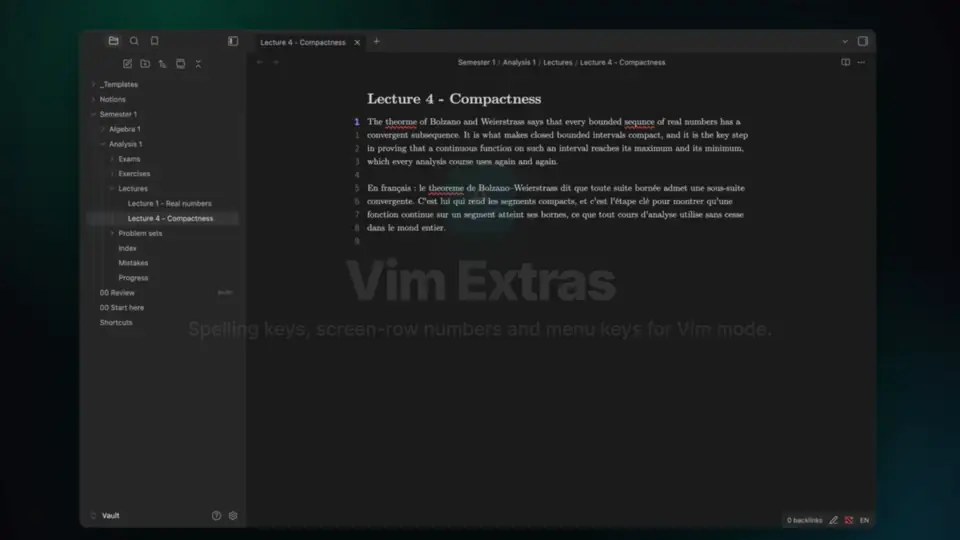
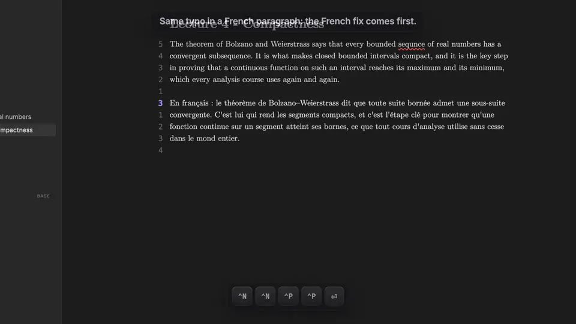

<p align="center">
  <b>The Vim keys Obsidian forgot.</b><br>
  Fix typos with <code>]s</code> and <code>z=</code>, count wrapped rows for <code>gj</code>, and drive every menu with <code>Ctrl-N</code> / <code>Ctrl-P</code>.
</p>

<p align="center">
  <a href="https://github.com/confuserdotcom/obsidian-vim-extras/releases/latest"></a>
  <a href="https://github.com/confuserdotcom/obsidian-vim-extras/releases"></a>
  <a href="https://github.com/confuserdotcom/obsidian-vim-extras/actions/workflows/test.yml"></a>
  <a href="https://github.com/confuserdotcom/obsidian-vim-extras/stargazers"></a>
  <a href="LICENSE"></a>
  
</p>

<p align="center">
  <a href="#spelling-keys">Spelling keys</a> ·
  <a href="#screen-row-numbers">Screen-row numbers</a> ·
  <a href="#ctrl-n--ctrl-p-in-menus">Ctrl-N / Ctrl-P</a> ·
  <a href="#vimrc">vimrc</a> ·
  <a href="#install">Install</a>
</p>

Three small additions to [Obsidian](https://obsidian.md)'s Vim mode, each with its own switch in the settings:

- **Spelling keys**: `]s` `[s` `z=` `zg` `zw`, like Vim's, on Obsidian's own spellchecker.
- **Screen-row numbers**: relative numbers that count what `gj` and `gk` really move by on wrapped lines, also beside rendered maths.
- **Ctrl-N / Ctrl-P in menus**: move the selection in Obsidian's menus, like in the quick switcher.

Requires Vim mode: Obsidian's built-in **Settings → Editor → Vim key bindings**, or the [Vim Motions](https://github.com/saberzero1/obsidian-vim-motions) plugin. Desktop only (the spellchecker is Electron's).

<p align="center">▶ <a href="docs/readme/demo.mp4"><b>Watch the full-quality video</b></a></p>

## Spelling keys



| Keys | What they do |
| --- | --- |
| `]s` `[s` | next / previous misspelled word; counts (`3]s`), operators (`d]s`) and visual mode work; wraps around the note like Vim |
| `z=` | fixes for the word under the cursor: `1`–`9` picks one, `Ctrl-N` / `Ctrl-P` + `Enter` too, `Esc` cancels |
| `3z=` | take fix 3 straight away (`1z=` = the best one) |
| `zg` | add the word to the dictionary |
| `zw` `zug` | take it back out |

- Only prose is checked: maths (`$…$`, `$$…$$`), code, frontmatter, links and their targets, URLs, file names, tags, comments, HTML, LaTeX commands, one-letter words and short ALL-CAPS acronyms are skipped.
- It uses the languages in **Settings → Editor → Spellcheck**, and `zg` / `zw` write to the same dictionary as the editor's right-click menu.
- Fast: the open note is checked and its fixes worked out while you pause, so `]s` and `z=` only read caches.
- **Own underline** (on by default) underlines the misspelled words the way `]s` sees them: the whole note at once, never inside maths or code. It hides the built-in underline in the editor.

### How `z=` ranks the fixes

It gathers every spelling one edit away (plus any accents: `theoreme` → `théorème`, `aparaitre` → `apparaître`) that the dictionary accepts, with Chromium's own suggestions, and ranks them by:

- **closeness**, with realistic costs: a missing accent or capital costs little, a doubled letter added or dropped (`problemme`) less than a random letter, and the key next door less than any other key (QWERTY, AZERTY or QWERTZ, read from the system);
- **how common the word is**, from your word lists (below): `mond` → `monde` before `mont` or `gond`;
- **the language of the paragraph** (below): in an English paragraph `theorme` → `theorem`, in a French one `théorème`;
- **your notes**: words you use often rank higher, so terms missing from any list (`surjective`, `Cauchy`) are known;
- **the words around it**: how often your notes have each fix next to the word before and the word after: `du mond blanc` → `mont`, `le mond entier` → `monde`;
- **your picks**: the fix you take for a typo comes first next time.

The typo's capitals are kept (`Bonjuor` → `Bonjour`).

### Word lists and languages

**Word lists** takes files of your vault, one per line. Each file has one word per line, best followed by how common it is, like the frequency lists of [FrequencyWords](https://github.com/hermitdave/FrequencyWords) (`content/2018/fr/fr_50k.txt`: `monde 277005`). Name each file after its language: `fr_50k.txt`, `en_50k.txt`, `french.txt` (files of the same language are merged).

With lists of two or more languages:

- each paragraph's language is detected from its words, and `z=` ranks that language's words first and pushes the other language's down: an English paragraph never gets French fixes first, and a note can mix both;
- a short or mixed paragraph takes the language of the whole note;
- the status bar shows the language at the cursor (`EN`, `FR`); click it, or run **Set the spelling language of this note**, to set one for the whole note. That writes `lang: en` in the note's frontmatter (shown in the accent colour); "Detect per paragraph" removes it.

Which words get underlined is still up to the system spellchecker, which accepts every language it has: a French word in an English note is not underlined, it is only never offered as a fix. On macOS the system checks every language you have, so it may take a word of another language as correct (`helo`, `mond`).

**Learn from your notes** (on by default) counts the words of your notes and which words follow which, and remembers the fixes you take, in the plugin's own data; the button next to it forgets the picks.

### Fast at startup

What `z=` knows (the word lists, your notes' words and word pairs) is compiled into one file, `model.bin` in the plugin folder: sorted tables and typed arrays, searched in place.

- **Startup**: the plugin's `onload` does no spelling work. Once Obsidian is idle, it reads `model.bin` and takes views on its bytes, without parsing lists or building tables: about 1 ms to decode, 8–16 ms with the disk read, measured on 150 000 words and 800 notes. Only the notes changed since the last session are read again.
- **Edits**: a note you change is counted again a moment after you stop typing: its old words and pairs out, the new ones in (0.1 ms for a typical note). New words go to a small layer next to the tables, saved with them when idle.
- **Full rebuilds** (first run, other word lists, many notes changed while closed) run in a background worker, off the editor's thread: about 0.7 s for that vault. **Rebuild the spelling model** forces one.
- `model.bin` is a cache of this device: keep it out of sync (Syncthing, Obsidian Sync, git); each device builds its own.

The three commands (**Spelling suggestions**, **Add word to dictionary**, **Remove word from dictionary**) also work from the command palette.

## Screen-row numbers



Notes wrap, so most people in Obsidian move with `gj` / `gk` (or map `j` / `k` to them): `5gj` goes 5 screen rows down, and no line numbers say where that is. This draws a relative number on every screen row in the left margin:

- the label on a row is exactly how many `gj` (or `gk`) land there; it comes from running Vim's own vertical motion, so rows beside rendered inline maths are skipped and a rendered `$$` block shows the count that reaches it, just like the cursor moves;
- the cursor row shows its real line number (hybrid, like `set number relativenumber`);
- it is drawn when the editor is idle, so holding `gj` stays smooth.

The numbers sit in the margin left of the text: turn on **Settings → Editor → Readable line length** so there is room. **Toggle screen-row numbers** is a command, to bind to a key. Resize them with a CSS snippet:

```css
body { --vim-extras-row-size: 19px; --vim-extras-row-cur-size: 21px; }
```

## Ctrl-N / Ctrl-P in menus

The quick switcher and the other suggesters already take `Ctrl-N` / `Ctrl-P`; menus (right-click menu, file menu, the `z=` list…) only took the arrow keys, and `Ctrl-N` fell through to **Create new note**. Now they move the selection. Needs **Settings → Appearance → Native menus** off: native menus are drawn by the system and never see the keys.

## vimrc

The spelling keys need counts, so they are plain Vim keys, not commands: don't map `z=` or `]s` in your vimrc, a map would shadow them. To bind the row numbers toggle, with [Vim Motions](https://github.com/saberzero1/obsidian-vim-motions):

```vim
nnoremap <leader>tn :obcommand vim-extras:toggle-row-numbers<CR>
```

With [Vimrc Support](https://github.com/esm7/obsidian-vimrc-support):

```vim
exmap rownumbers obcommand vim-extras:toggle-row-numbers
nmap <Space>tn :rownumbers<CR>
```

## Install

Until it is in the community plugins list, either:

- use [BRAT](https://github.com/TfTHacker/obsidian42-brat): add `confuserdotcom/obsidian-vim-extras`, or
- download `main.js`, `manifest.json` and `styles.css` from the [latest release](https://github.com/confuserdotcom/obsidian-vim-extras/releases/latest) into `<vault>/.obsidian/plugins/vim-extras/`, then enable **Vim Extras** in Settings → Community plugins.

## Development

No build step: `main.js` is the plugin.

```sh
npm test               # unit tests for the spelling keys
node e2e.mjs           # real key presses in a running Obsidian (see the header of e2e.mjs)
node e2e-isolated.mjs  # the same in a separate Obsidian with a throwaway vault (macOS)
```

`tools/eval.js` measures how often `z=` puts the right fix first, against releases 1.0.0 and 1.1.0, on real typos mined from a vault's git history (`tools/mine-typos.py`) and on synthetic ones:

```sh
node tools/eval.js <vault> tools/typos.json fr_50k.txt en_50k.txt
node --expose-gc tools/bench.js <vault> fr_50k.txt en_50k.txt   # build, size, load, edit, save, z=
```

`npm test` also checks that the incremental path lands exactly where a full rebuild does (200 random runs of notes edited, deleted and renamed), and that the worker's source builds the very same bytes.

## Support

The plugin is free and stays free. If it saves you time, you can [support it here](https://confuserdotcom.lemonsqueezy.com).

## License

[MIT](LICENSE)

---

<p align="center">
  If Vim Extras saves you a trip to the mouse, <a href="https://github.com/confuserdotcom/obsidian-vim-extras">a ⭐ on GitHub</a> helps other Vim users find it.<br>
  Bugs and ideas: <a href="https://github.com/confuserdotcom/obsidian-vim-extras/issues">open an issue</a>.
</p>

<a href="https://star-history.com/#confuserdotcom/obsidian-vim-extras&Date">
  <picture>
    <source media="(prefers-color-scheme: dark)" srcset="https://api.star-history.com/svg?repos=confuserdotcom/obsidian-vim-extras&type=Date&theme=dark">
    
  </picture>
</a>
